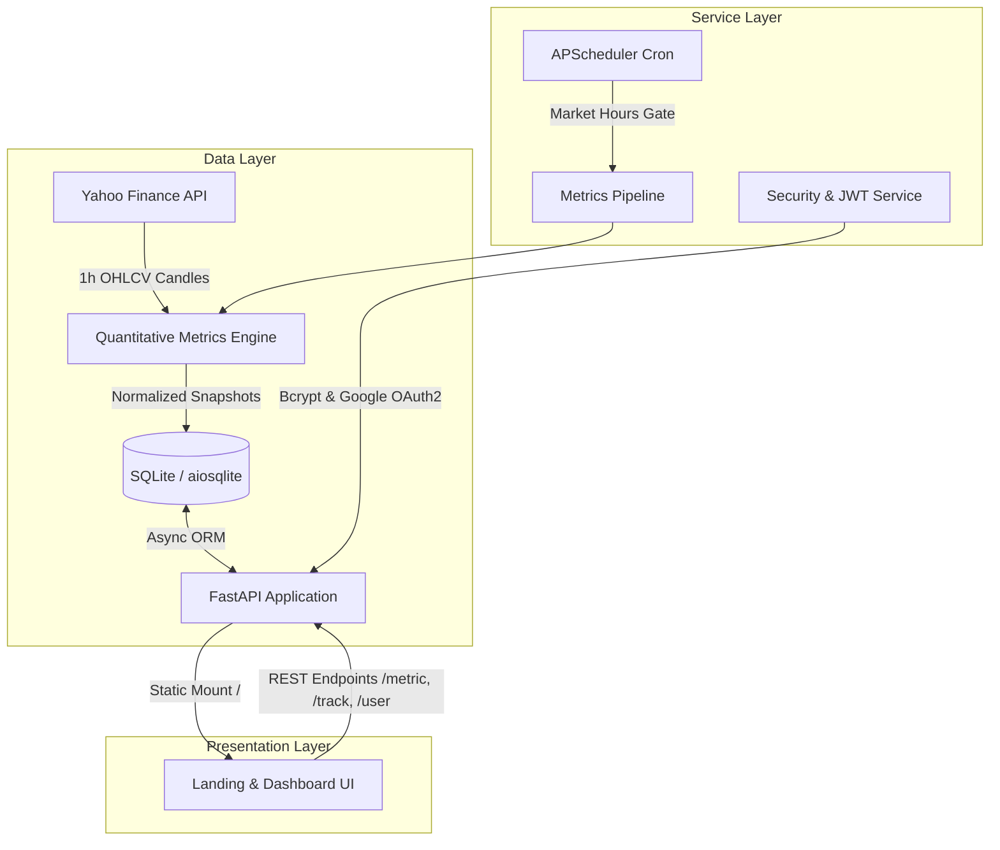

# MarketPulse

> Quantitative market telemetry engine and full-stack decision-support platform delivering objective volatility, trend, and risk metrics without predictive bias.

[](https://www.python.org/)
[](https://fastapi.tiangolo.com/)
[](https://www.sqlalchemy.org/)
[](LICENSE)

---

## 1. Architectural Overview

MarketPulse processes raw 1-hour OHLCV candle streams to compute a 4-factor decoupled risk model. It eliminates predictive gambling and retail trading sentiment noise by exposing mathematically grounded market physics: trend momentum, volatility regime, directional strength, and composite risk scoring.



---

## 2. Quantitative Model & Risk Engine

The quantitative pipeline implemented in [`src/service/calculate_metrics.py`](file:///C:/Users/blaze/WorkSpace/projects/web/MarketPulse/src/service/calculate_metrics.py) evaluates at least 65 continuous 1-hour bars per active ticker.

### 2.1 Trend Analysis
- **Fast EMA:** 20-period Exponential Moving Average ($\text{EMA}_{20}$)
- **Slow EMA:** 50-period Exponential Moving Average ($\text{EMA}_{50}$)
- **Spread Percentage:**
  $$\text{Spread}_{\%} = \left(\frac{\text{EMA}_{20} - \text{EMA}_{50}}{\text{EMA}_{50}}\right) \times 100$$
- **Classification:**
  - `BULLISH`: $\text{Spread}_{\%} > 0.15\%$ and $\text{Close} > \text{EMA}_{20}$
  - `BEARISH`: $\text{Spread}_{\%} < -0.15\%$ and $\text{Close} < \text{EMA}_{20}$
  - `NEUTRAL`: Conditions not met or range-bound

### 2.2 Volatility & Expansion
- **True Range (TR):** $\max(H - L, |H - C_{prev}|, |L - C_{prev}|)$
- **ATR(14):** Wilder's exponential smoothing ($\alpha = 1/14$)
- **NATR (Normalized ATR):** $(\text{ATR}_{14} / \text{Close}) \times 100$
- **ATR Baseline:** 50-period simple moving average of $\text{ATR}_{14}$
- **ATR Ratio:** $\text{ATR}_{14} / \text{ATR}_{baseline}$
  - `ELEVATED`: $\text{ATR Ratio} > 1.3$
  - `LOW`: $\text{ATR Ratio} < 0.8$
  - `NORMAL`: $0.8 \le \text{ATR Ratio} \le 1.3$

### 2.3 Regime & Directional Movement
- **Wilder's ADX(14):** Directional Movement indices ($+DI$, $-DI$) and smoothed Average Directional Index.
- **Directional Conflict:** Measures directional uncertainty between $+DI$ and $-DI$.

### 2.4 Momentum
- **Wilder's RSI(14):** Relative Strength Index using Wilder's smoothing ($\alpha = 1/14$).
  - `OVERBOUGHT`: $\text{RSI} \ge 70.0$
  - `OVERSOLD`: $\text{RSI} \le 30.0$
  - `BALANCED`: $30.0 < \text{RSI} < 70.0$

### 2.5 Component-Decoupled Composite Risk Score
The composite risk score ($0 \text{ to } 100$) computes weighted exposure across three distinct failure axes:

| Factor | Weight | Inputs & Scoring Mechanics |
| :--- | :---: | :--- |
| **Trend Risk** | 40% | Distance below $\text{EMA}_{50}$ (50 pts), negative spread deficit (30 pts), distance below $\text{EMA}_{20}$ (20 pts) |
| **Volatility Risk** | 35% | ATR ratio expansion $> 0.9$ (70 pts), RSI deviation from midpoint 50 (30 pts) |
| **Regime / Chop Risk** | 25% | ADX chop score ($28 - \text{ADX}$) (70 pts), DI conflict metric (30 pts) |

**Risk Level Categories:**
- `LOW`: $0 \le \text{Score} \le 34$
- `MODERATE`: $35 \le \text{Score} \le 65$
- `HIGH_RISK`: $66 \le \text{Score} \le 100$

---

## 3. Project Structure

```
MarketPulse/
├── alembic.ini                   # Alembic database migration configuration
├── database.db                   # SQLite primary database
├── main.py                       # Uvicorn entry point
├── pyproject.toml                # Project metadata and dependencies
├── run_cron.py                   # Manual trigger for metrics calculation
├── scripts/
│   ├── env.py                    # Alembic migration environment
│   ├── seed_stocks.py            # Ticker bootstrap script (NSE + US tech)
│   └── versions/                 # Database migration revision scripts
├── src/
│   ├── app.py                    # FastAPI application initialization & routing
│   ├── config.py                 # Pydantic Settings (.env management)
│   ├── database.py               # Async SQLAlchemy engine, session & models
│   ├── model.py                  # Pydantic schemas and enums
│   ├── endpoint/
│   │   ├── health.py             # Health check endpoint
│   │   ├── metrics.py            # Public & tracked market metric queries
│   │   ├── track_stock.py        # User stock watchlist & bookmarking
│   │   └── user.py               # Authentication & user profile endpoints
│   └── service/
│       ├── calculate_metrics.py  # Quantitative indicators & risk algorithm
│       ├── schedular.py          # APScheduler background cron setup
│       ├── track_service.py      # Watchlist persistence logic
│       ├── update_metrics.py     # Market session validation & update loop
│       ├── user_security.py      # JWT encoding, decoding & route dependencies
│       └── user_service.py       # User registration, bcrypt verification & Google OAuth
└── static/
    ├── dashboard.html            # Core telemetry dashboard
    ├── index.html                # Platform landing page & authentication modal
    ├── css/                      # Responsive stylesheets (dashboard.css, style.css)
    └── js/                       # Client controllers (auth.js, dashboard.js, landing.js)
```

---

## 4. API Specification

All authenticated routes require a JSON payload containing `{"access_token": "<JWT>", "token_type": "Bearer"}` or the appropriate schema.

| Method | Endpoint | Description | Auth Required |
| :--- | :--- | :--- | :---: |
| `GET` | `/check/health` | Service health status check | No |
| `POST` | `/user/register` | Register new user via email & password | No |
| `POST` | `/user/signup` | Authenticate existing user | No |
| `POST` | `/user/api/auth/google` | Verify Google OAuth2 ID token and issue JWT | No |
| `POST` | `/user/info` | Fetch current authenticated user profile | Yes |
| `POST` | `/user/access` | Validate session token vitality | Yes |
| `POST` | `/metric/` | Retrieve latest metric snapshot across all active stocks | Yes |
| `POST` | `/metric/tracked` | Retrieve latest metric snapshot for user's watchlisted stocks | Yes |
| `POST` | `/track?stock_symbol={sym}` | Add stock to user watchlist | Yes |
| `DELETE` | `/track?stock_symbol={sym}` | Remove stock from user watchlist | Yes |
| `POST` | `/track/tracked_list` | List all tracked symbols for the user | Yes |

---

## 5. Environment Configuration

Create a `.env` file in the root directory:

```ini
# Market Session Configuration (IST)
MARKET_OPEN_TIME="9:14"
MARKET_CLOSE_TIME="15:45"

# Cron Schedule Settings
CORN_JOB_SECOND=0
CORN_JOB_MINUTE="*/15"
CORN_JOB_HOUR=""
CORN_JOB_DAY=""

# Authentication Security
JWT_SECRET="replace-with-a-secure-random-secret-key-at-least-32-chars"
JWT_EXPIRE_DAYS=30
JWT_ALGO="HS256"

# Google OAuth2 Credentials
GOOGLE_CLIENT_ID="your-google-client-id.apps.googleusercontent.com"
GOOGLE_CLIENT_SECRET="your-google-client-secret"
```

---

## 6. Installation & Execution

### 6.1 Prerequisites
- Python 3.12 or newer
- [`uv`](https://github.com/astral-sh/uv) (recommended) or standard virtualenv

### 6.2 Setup Environment
```bash
# Clone the repository
git clone https://github.com/your-username/MarketPulse.git
cd MarketPulse

# Sync dependencies using uv
uv sync
```

### 6.3 Database Migrations & Seeding
```bash
# Run database migrations
uv run alembic upgrade head

# Seed initial stock universe (NIFTY 50 blue chips & benchmarks)
uv run python -m scripts.seed_stocks
```

### 6.4 Run Development Server
```bash
uv run python main.py
```
The application will be accessible at:
- Web Interface: `http://localhost:8000`
- Interactive API Docs: `http://localhost:8000/docs`

### 6.5 On-Demand Metrics Calculation
To execute an immediate metric computation pass outside or inside the scheduled cron:
```bash
uv run python run_cron.py
```
